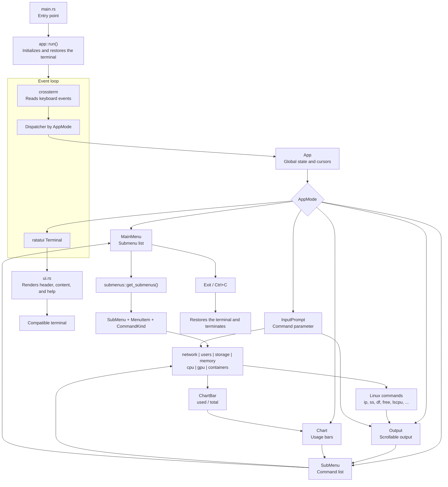

# core_menu — Documentation

Linux system manager with an interactive terminal user interface (TUI) that runs in any compatible terminal.

---

## Contents

| Document | Description |
|-----------|-------------|
| [instalacion.md](doc/instalacion.md) | Requirements, compilation, and binary installation |
| [uso.md](doc/uso.md) | Menu navigation, keyboard shortcuts, and available submenus |
| [extension.md](doc/extension.md) | How to add new submenus and system commands |

---

## Quick Overview

```
┌─────────────────────────────────────────────────────────┐
│               CORE MENU  —  Linux System Manager        │
├─────────────────────────────────────────────────────────┤
│                                                         │
│  ▶ Network            Network and firewall status        │
│    Users              System users and sessions          │
│    Storage            Disks, partitions, and space usage │
│    Memory             RAM status and usage               │
│    CPU                Processor, cores, and temperature  │
│    GPU                Graphics card, VRAM, and GPU usage │
│    Virtualization     KVM, Docker/Podman, containers     │
│    ──────────────────────────────────────────────────   │
│    Exit                                                 │
│                                                         │
├─────────────────────────────────────────────────────────┤
│    ↑↓/jk: Navigate   Enter: Select   q: Exit            │
└─────────────────────────────────────────────────────────┘
```

---

## Architecture

`core_menu` separates the application loop, navigation state, TUI rendering,
and commands grouped by system area:



The main flow is `MainMenu -> SubMenu -> Output` (or `InputPrompt` /
`Chart`) and returns to the submenu after displaying the result. To extend the
application, implement each new area as a module under `src/submenus/` and
register it in `get_submenus()`.

---

## Usage Guide

### Starting the Application

```bash
./core_menu          # binary in the current directory
# or if it is in PATH:
core_menu
```

The application uses the terminal's alternate screen and restores it on exit.

### Navigation

| Key | Action |
|-------|--------|
| `↑` / `k` | Move the cursor up |
| `↓` / `j` | Move the cursor down |
| `Enter` | Select an option / run a command |
| `Esc` / `q` | Return to the previous level |
| `Ctrl+C` | Exit immediately |

Navigation works the same way in the main menu, submenus, and command output screen.

### Screens

**Main menu** — list of available submenus. Select one with `Enter`.

**Submenu** — list of commands for the selected area. Each entry shows a name and description. Press `Enter` to run it.

**Command output** — text returned by the command. Scroll with `↑`/`↓` or `j`/`k`. Return with `Esc`.

**Parameter input** — some commands request a value before running (for example, a modem index or container ID). Enter the value and confirm with `Enter`. A default value is shown and can be kept or replaced.

**Bar chart** — storage and memory commands can show a color-coded bar screen:
- Green: usage < 70%
- Yellow: usage between 70% and 90%
- Red: usage ≥ 90%

---

## Available Submenus

### Network
Inspect network and firewall status.

| Command | Description |
|---------|-------------|
| Network interfaces | Interfaces and their IPs (`ip addr`) |
| Listening ports | Active TCP/UDP ports (`ss -tulnp`) |
| Established connections | Active TCP connections (`ss -tnp`) |
| Routing table | Active network routes (`ip route show`) |
| UFW firewall | Active UFW rules |
| iptables rules | iptables filter table (requires root) |
| DNS configuration | Configured DNS servers |
| Interface statistics | Packet/byte counters |
| ARP / neighbors | ARP and IPv6 ND table |
| Detected modems | Modems managed by ModemManager |
| Modem status | Detailed modem information by index *(parameter input)* |

### Users
Manage users, groups, and sessions.

| Command | Description |
|---------|-------------|
| Logged-in users | Active sessions (`who -a`) |
| Current activity | Users, uptime, and active processes (`w`) |
| Recent logins | Login history (`last -n 30`) |
| Failed attempts | Failed logins (`lastb`, requires root) |
| Users with login shells | Accounts that can log in |
| All users | Complete `/etc/passwd` listing |
| System groups | `/etc/group` listing |
| Current identity | UID, GID, and groups for the current process |
| Sudo privileges | Commands allowed for the user (`sudo -l`) |

### Storage
Disks, partitions, filesystems, and device health.

| Command | Description |
|---------|-------------|
| Disk usage | Free/used space by filesystem (`df -h`) |
| Inode usage | Inode availability (`df -i`) |
| Block devices | Disks and partitions with details (`lsblk`) |
| Physical disk information | Model, size, and transport type |
| Mount points | Mounted filesystems |
| Largest directories | Top 20 directories by size |
| Current directory usage | Size of each entry in `$PWD` |
| Disk SMART health | SMART status (requires `smartmontools`) |
| Usage chart | *(bar screen)* Usage by filesystem |

### Memory
RAM, swap, and kernel cache status and usage.

| Command | Description |
|---------|-------------|
| Memory summary | Free/used RAM and swap (`free -h`) |
| Detailed summary | RAM in MB with extended columns |
| Complete kernel information | All fields from `/proc/meminfo` |
| Available memory | Total, free, and available RAM |
| Swap status | Swap partitions and files |
| Top processes by RAM | 20 processes with the highest usage |
| Processes with RSS > 100 MB | Processes using more than 100 MB |
| Kernel cache usage | Buffers, page cache, and slab |
| Memory chart | *(bar screen)* RAM and swap |

### CPU
Processor status, per-core performance, and temperature.

| Command | Description |
|---------|-------------|
| Processor information | Model, cores, and frequencies (`lscpu`) |
| System load | 1, 5, and 15-minute load averages (`uptime`) |
| Active processes (CPU) | Top 20 processes sorted by CPU usage |
| CPU statistics (vmstat) | CPU activity in five 1-second samples |
| Per-core frequency | Current frequency of each core (MHz) |
| CPU temperature | Temperature sensors (`sensors` / sysfs) |
| Processor cache | L1, L2, and L3 sizes (`lscpu -C`) |
| Per-core interrupts | First 30 lines of `/proc/interrupts` |
| Per-core usage (chart) | *(bar screen)* CPU usage per core, sampled for 250 ms |

### GPU
Graphics card, VRAM, and temperature status. Supports NVIDIA (`nvidia-smi`) and AMD (the `amdgpu` driver via sysfs).

| Command | Description |
|---------|-------------|
| Detected GPUs | Installed graphics cards (`lspci`) |
| Active driver | Driver used by each GPU |
| NVIDIA status (nvidia-smi) | Complete `nvidia-smi` summary |
| Processes on NVIDIA GPU | Processes using the NVIDIA GPU |
| AMD status (sysfs) | Usage, VRAM, and temperature via the `amdgpu` driver |
| GPU temperature | Temperature via `sensors` or sysfs |
| DRM devices | Kernel rendering nodes (`/dev/dri`) |
| GPU usage (chart) | *(bar screen)* Utilization and VRAM per GPU |

### Virtualization
Manage KVM and container engines (Docker, Podman, Nerdctl, and more).

| Command | Description |
|---------|-------------|
| KVM module status | kvm_amd / kvm_intel / kvm depending on the CPU |
| Enable / disable KVM | Load or unload the KVM module (sudo) |
| Detected engine | Docker, Podman, and Nerdctl installed in PATH |
| Service status | systemd status of the container engine |
| Running containers | Containers currently running |
| All containers | Running and stopped containers |
| Container count | Count of running and total containers |
| Images | Available local images |
| Dangling images | Untagged images |
| Volumes | Volumes managed by the engine |
| Unused volumes | Volumes without an associated container |
| Virtual networks | Networks managed by the container engine |
| Start Docker | Start the Docker service (`sudo systemctl`) |
| Start Podman | Start the Podman socket/service (sudo) |
| Start Nerdctl (containerd) | Start the containerd service (`sudo systemctl`) |
| Start Lima | Start the default Lima VM (`limactl start`) |
| Resource statistics | CPU and RAM usage of running containers |
| Space usage | Space used by images, containers, and volumes |
| System information | Engine version and configuration |

---

## Releases

New precompiled binaries are published as assets of
[GitHub Releases](https://github.com/juancasanovalopez/core_menu/releases).
Versions follow [Semantic Versioning](https://semver.org/): `MAJOR.MINOR.PATCH`,
with tags such as `v1.1.0` matching the version in `Cargo.toml`.
Linux x86_64 and ARM64 releases use static musl executables.

### Automatic updates

At startup, core_menu checks GitHub's stable **latest** release in the background.
It compares SemVer precedence numerically and never installs equal or older
versions. Drafts and prereleases are not installed; build metadata alone does
not make a version newer.

When an update is available, the offer appears in the main menu without
interrupting a submenu or text entry. Accept with `s` to download and verify
the Ed25519 signature, architecture, size and SHA-256, then confirm again with
`s` to replace the executable. `n`/`Esc` cancels. Use `u` from the main menu
to inspect status and `↑`/`↓` to scroll details.

User-owned installations update without sudo. A system installation must be
at `/usr/local/bin/core_menu`; sudo is requested only for the final replacement.
Package-managed executables must be updated through their package manager.
Start without sudo to download/install an update. The old executable is retained
in a recovery directory, and the application closes after installation:
**restart manually** to use the new version.

Connection errors do not prevent normal use. An inaccessible or absent stable
release is reported separately from being up to date. Older binaries without
this updater require one initial manual installation.

See [installation and release publishing](doc/instalacion.md#7-updates-and-release-publishing)
for assets, signature verification, signing-secret setup and recovery.
The files in [`releases/v1.0.0/`](releases/v1.0.0/) are historical binaries,
not the source used by the automatic updater.

### Version History

| Version | Date | Notes |
|---------|-------|-------|
| [v1.0.0](releases/v1.0.0/) | 2026-04-13 | First stable production release |

---

## Technology

- **Language:** Rust 2021 edition
- **TUI:** [ratatui](https://ratatui.rs) v0.26 on top of [crossterm](https://github.com/crossterm-rs/crossterm) v0.27
- **Error handling:** [anyhow](https://github.com/dtolnay/anyhow) v1.0
- **Release binaries:** static musl builds for Linux x86_64 and ARM64
